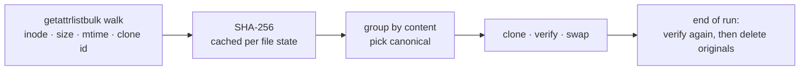

<div align="center">

# nm-dedupe

**Every `node_modules` on your Mac holds the same files over and over.<br>nm-dedupe stores each of them once, without npm noticing and without losing a byte.**

[](https://github.com/michaellocher/nm-dedupe/actions/workflows/ci.yml)
[](https://github.com/michaellocher/nm-dedupe/releases)
[](LICENSE)


[Website](https://michaellocher.github.io/nm-dedupe/) · [Install](#install) · [How it works](#how-it-works) · [Safety](#safety)

</div>

```console
$ bench/sample-projects.sh /tmp/bench      # 12 typical projects: React, Next, Vite, TypeScript, ESLint, Jest, …
$ nm-dedupe -n /tmp/bench
scanned 12 node_modules, 73070 files, 1.4 GB logical
hashed 73070 files (1.4 GB), 0 from cache
duplicates: 53436 files, 980.4 MB logical; already cloned: 0; to clone: 53436, expected to free 1.1 GB
dry-run: would clone 53436 files, expected to free 1.1 GB
$ nm-dedupe /tmp/bench
nm-dedupe: cloned 53436, skipped 0, errors 0; free space … (measured +1.1 GB, expected 1.1 GB)
```

<sub>Reproducible with <code>bench/sample-projects.sh</code> (current package versions as of November 2026).
Dry run 2.4 s, real run 22 s, 32 MB peak memory. The forecast is above the logical size because APFS
allocates at least one 4 KB block per file, and most files in node_modules are small.</sub>

## Why

Each project gets its own full copy of every dependency. Across a few hundred projects that's
gigabytes of identical bytes. pnpm fixes this with hard links, but then you aren't using npm, and
editing a file in one project (patch-package, debugging) silently changes it everywhere.

nm-dedupe takes another route: **APFS clones**. A clone is an independent, ordinary file that
shares its disk blocks with the original until one of them is written to (copy-on-write).

|                                        | copies (npm) | hard links (pnpm) | **APFS clones (nm-dedupe)** |
|----------------------------------------|:------------:|:-----------------:|:---------------------------:|
| disk usage                             | n × size     | 1 × size          | **1 × size**                |
| works with plain npm / yarn            | ✅           | ❌                | ✅                          |
| editing one project affects the others | no           | **yes**           | no                          |
| tools can tell the difference          | –            | yes (link count)  | no                          |

## Install

```sh
# prebuilt universal binary (Apple Silicon + Intel)
curl -fsSL https://github.com/michaellocher/nm-dedupe/releases/latest/download/nm-dedupe-macos-universal.tar.gz \
  | sudo tar -xz -C /usr/local/bin

# or from source
cargo install --git https://github.com/michaellocher/nm-dedupe
```

## Use

```sh
nm-dedupe -n ~/Developer        # dry run: what would be freed, measured from APFS
nm-dedupe ~/Developer           # do it; prints free disk space before and after
nm-dedupe                       # current directory
```

**Automatically after every `npm install`:**

```sh
nm-dedupe hook >> ~/.zshrc
```

This wraps `npm` in a shell function: after a successful `install`, `ci`, `update` or `add`,
the project is deduped against every file nm-dedupe has seen before (index in
`~/.cache/nm-dedupe`).

| option | |
|---|---|
| `-n, --dry-run` | measure only, change nothing |
| `-q, --quiet` | one summary line |
| `-j, --jobs N` | parallel I/O threads (default 8, the measured optimum) |
| `--min-size N` | ignore files smaller than N bytes |
| `--no-index` | don't use or update the cross-run index |

## How it works



1. **Scan** every `node_modules` with `getattrlistbulk(2)`, one syscall per batch of entries,
   in parallel. Symlinks, hard links, other users' files and files with flags or ACLs are left alone.
2. **Hash** files with SHA-256. Hashes are cached by inode, size and mtime, so the next run only
   reads what changed.
3. **Group** identical files. Files that are already clones of each other (same APFS clone id)
   count as one physical copy; the biggest such cluster becomes the clone source.
4. **Replace** each duplicate safely (below), then measure the real change in free space.

## Safety

nm-dedupe never deletes data it hasn't proven to exist elsewhere, byte for byte.

For every file:

1. The source is cloned to a temp name next to the target, and the target's mode, group,
   timestamps and extended attributes are copied onto it.
2. Clone and target are **compared byte for byte**. Hashes and timestamps are never trusted
   alone, because tools like `tar`, `rsync -t` and npm itself reset mtimes.
3. Clone and target are **swapped atomically** (`renamex_np(RENAME_SWAP)`). The original
   is kept under the temp name.
4. At the end of the run each original is **hashed again**. It's deleted only if it still holds
   exactly the verified content. If something wrote to it meanwhile, it's swapped back. If
   both copies changed, both are kept (`<name>.nm-dedupe-recovered`).

One exception: `com.apple.provenance`, which macOS assigns per installing app and doesn't let
userspace set, keeps the value of the clone source. Every other attribute must match exactly.

If the process is killed at any point, the next run finds the leftover temp file and deletes it
only if it is byte-identical to its target. Otherwise the data is kept.

### Tested, not assumed

`cargo test` runs 19 scenarios against real APFS, each asserting that every file keeps its content,
size, mode, mtime, owner, group, flags and xattrs:

- hard crashes injected **before and after the swap**, and `SIGKILL` at random moments
- writers modifying files **while nm-dedupe runs**: in place, with mtime restored, and via rename
- writes through **file descriptors opened before the run**, and writes racing the swap-back
- stale hash caches with forged mtimes, edited or deleted canonical files
- read-only directories, unreadable files, immutable files, ACLs, hard links, symlinks
- file names with spaces, tabs, newlines, Unicode (NFC + NFD), 255-byte names, deep paths

Each safety mechanism is covered by mutation testing: disabling it makes a specific test fail.

## Limits

- **macOS with APFS only.** Clones can't cross volumes.
- A process that keeps a file open and writes to it **after** nm-dedupe has finished writes to
  the replaced original. The same happens when npm itself replaces a file.
- Local Time Machine snapshots keep the old blocks until they expire, so free space can grow later
  than the run (nm-dedupe says so when snapshots exist).
- The release binary isn't notarized. If you download it with a browser, run
  `xattr -d com.apple.quarantine nm-dedupe` once.

## Development

```sh
cargo test --release                                  # safety suite (APFS required)
tests/e2e-npm.sh                                      # real npm packages, end to end
bench/sample-projects.sh /tmp/bench && nm-dedupe -n /tmp/bench   # benchmark
cargo clippy --all-targets -- -D warnings && cargo fmt --check
npx jscpd --min-tokens 30 --format rust src tests     # duplicate code
```

Releases: bump `version` in `Cargo.toml`, tag it without a `v` prefix (`git tag 0.2.0`) and push
the tag. CI builds a universal binary and publishes the GitHub release.

## License

[MIT](LICENSE)
